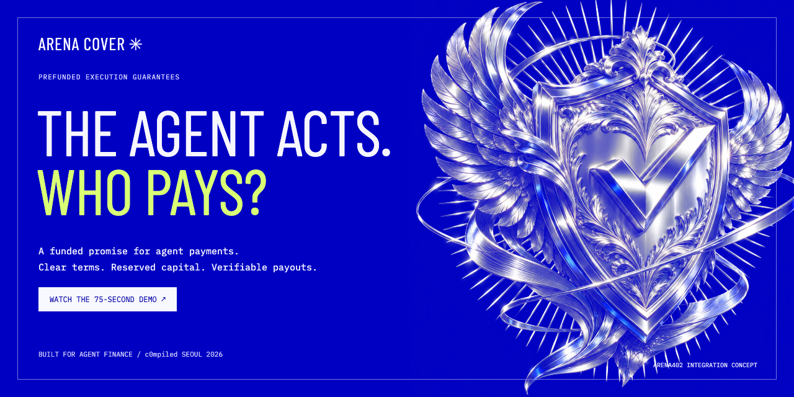
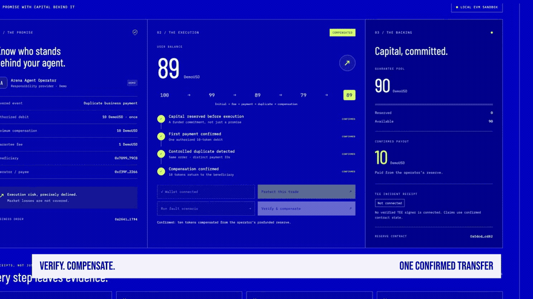
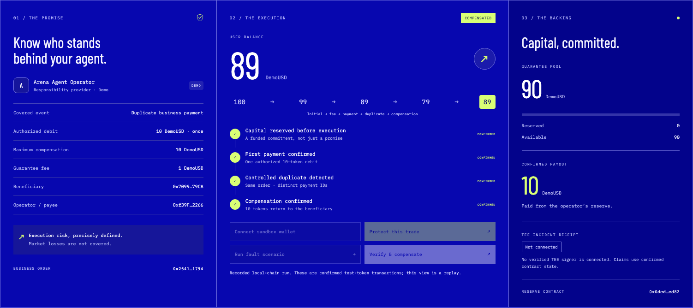
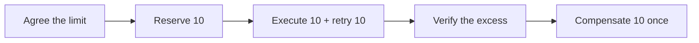

# ArenaCover

[English](./README.md) · [한국어](./README.ko.md) · [中文](./README.zh-CN.md)

[](https://youtu.be/0WrEHcNbB64)

### 에이전트가 두 번 결제하면, 누가 돌려줄까요?

**사전에 예치한 자본으로 에이전트 결제 오류를 보상합니다.** 운영자가 책임을 약속하고, 컨트랙트가 보상금을 확보합니다. 중복 결제를 검증하면 초과 금액을 한 번만 지급합니다.

**[▶ 75초 영어 영상](https://youtu.be/0WrEHcNbB64) · [↗ 라이브 데모](https://arenacover-seoul-20261109.vercel.app) · [거래 영수증](./public/evidence/run.json)**

[](https://github.com/sunruize93-cmyk/arenacover-seoul-20261109/actions/workflows/ci.yml) &nbsp; Solidity · Next.js · viem · c0mpiled Seoul 2026

*실제 데모: 로컬 EVM, chain 31337. 배포 대상: Injective EVM Testnet, chain 1439. 호스팅 페이지는 명시된 읽기 전용 리플레이입니다.*

## 자본이 뒷받침하는 책임

에이전트는 스스로 결제할 수 있습니다. 실행 전에 오류의 책임도 분명해야 합니다.

| 먼저 확보 | 초과 금액 검증 | 한 번만 보상 |
| --- | --- | --- |
| 운영자가 100 DemoUSD를 예치하고 실행 전에 10을 예약합니다. | 주문 하나가 10의 결제를 한 번 허용하지만 오류 주입기가 두 번째 결제를 만듭니다. | 컨트랙트가 초과된 10을 사용자에게 돌려주고 청구를 닫습니다. |

첫 연동 대상은 Arena402입니다. 이번 MVP는 고정 주문의 책임 흐름에 집중합니다. 조건을 정하고, 자본을 확보하고, 초과 결제를 검증하고, 지급 결과를 확인할 수 있게 합니다.

## 약속이 지급으로 바뀌는 순간

[](https://youtu.be/0WrEHcNbB64)

*실제 영상의 6초 무음 미리보기입니다. [음악과 영어 내레이션이 있는 전체 영상 →](https://youtu.be/0WrEHcNbB64)*

| 사용자 잔액 | 운영자 자본 풀 | 증거 |
| --- | --- | --- |
| 보상 후 **79 → 89** | **100 → 90** | **확인된 거래 영수증 4개** |

전체 흐름: **100 → 99**(보장료) **→ 89**(결제) **→ 79**(중복 결제) **→ 89**(보상). 모든 금액은 가치가 없는 DemoUSD 테스트 토큰입니다.

## 실행할 수 있는 제품

[](https://arenacover-seoul-20261109.vercel.app)

보장 활성화 → 오류 시나리오 → 검증 및 보상. 로컬 버전에서는 직접 전 과정을 실행합니다. 온라인 리플레이에서는 심사자가 확인된 결과를 바로 볼 수 있습니다.



[`DemoUSD`와 `ArenaCoverDemo`](./contracts/ArenaCover.sol), 두 컨트랙트로 구성합니다. 실행과 보장 로직은 같은 데모 컨트랙트에 있습니다. [아키텍처와 신뢰 경계](./docs/ARCHITECTURE.md).

## 로컬 실행

Node.js **22+**가 필요합니다. 터미널 1:

```bash
npm ci
npm run compile:contracts
npm run chain
```

체인을 유지하고 터미널 2에서 실행합니다.

```bash
npm run deploy:local
npm run dev
```

[localhost:3000](http://127.0.0.1:3000)에서 샌드박스 지갑 연결 → 보장 활성화 → 오류 실행 → 보상 순으로 진행합니다. 배포당 주문 하나이며 재배포로 새 주문을 준비합니다. 샌드박스는 공개 개발용 니모닉을 쓰므로 실제 자산을 보내면 안 됩니다.

## 결과 검증

```bash
npm test
npm run typecheck
npm run build
```

**컨트랙트 동작 6개, 서명 네트워크 방어 3개**를 테스트합니다. GitHub Actions가 테스트와 프로덕션 빌드를 실행합니다. 브라우저 증거에는 성공한 거래 4개, 최종 사용자 / 풀 잔액 **89 / 90**, 예약액 **0**이 기록되어 있습니다.

[검증 기록](./VERIFICATION.md) · [실행 JSON](./public/evidence/run.json) · [배포 정보](./public/deployment.json)

## 현재 구현 범위

| 기능 | 상태 |
| --- | --- |
| 로컬 EVM 결제, 자본 예약, 보상 | 구현 및 시연 완료 |
| 온라인 화면과 75초 영어 영상 | 공개 완료; README는 영어·한국어·중국어 지원 |
| Injective EVM Testnet 배포 도구 | 준비 완료; 공개 테스트넷 배포는 미완료 |
| Arena402 | 첫 연동 대상; 결제 단계와 증거 설계 참고 |
| TEE / x402 | 이번 빌드에는 연결되지 않음 |

이 데모의 중복 업무 결제만 보장합니다. 시장 손실, 전략 성과, 만료와 다중 주문 인수는 MVP 밖입니다. 정식 보험 상품이나 독립적인 외부 에이전트 오라클이 아닌 프로토타입입니다.

## 더 살펴보기

| 빠르게 보기 | 자세히 보기 |
| --- | --- |
| [심사자 빠른 안내](./docs/REVIEWER_GUIDE.md) | [아키텍처와 컨트랙트 흐름](./docs/ARCHITECTURE.md) |
| [개발 및 테스트넷 설정](./docs/DEVELOPMENT.md) | [편집 가능한 영상 프로젝트](./video/README.md) |
| [문서 목차](./docs/README.md) | [출처·디자인·미디어 크레딧](./docs/CREDITS.md) |

<details>
<summary>Arena402 과거 테스트넷 지갑</summary>

Injective EVM Testnet · Chain ID **1439**.

| 역할 | 주소 | 과거 용도 |
| --- | --- | --- |
| Facilitator | `0x7fB8d49698E40656F727511Da6251D3e6dfFaD50` | Faucet 수령, 컨트랙트 배포, Gas 지불 |
| Seller | `0x93Dafa6bFa2428CA033e8d6Fe9C94e40d1AC8754` | 거래 테스트의 판매자 수령 지갑 |

소유자가 확인한 기존 `agent-arena/settlement/deployments.json`의 주소입니다(Facilitator: 19행). 이번 문서 업데이트에서는 잔액을 다시 조회하지 않았습니다. [주소 JSON](./docs/arena402-historical-testnet-wallets.json) · [이전 리소스 스냅샷](./RESOURCE_STATUS.md).

</details>

Arena402를 fork하지 않은 신규 저장소입니다. **c0mpiled-17 Seoul · Crypto 트랙**을 위해 2026년 11월 9일 개발했습니다. [초기 기획](./PLANNING_README.md) · [제출 기록](./delivery/SUBMISSION.md)
