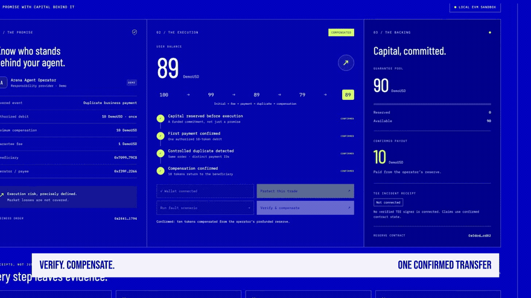
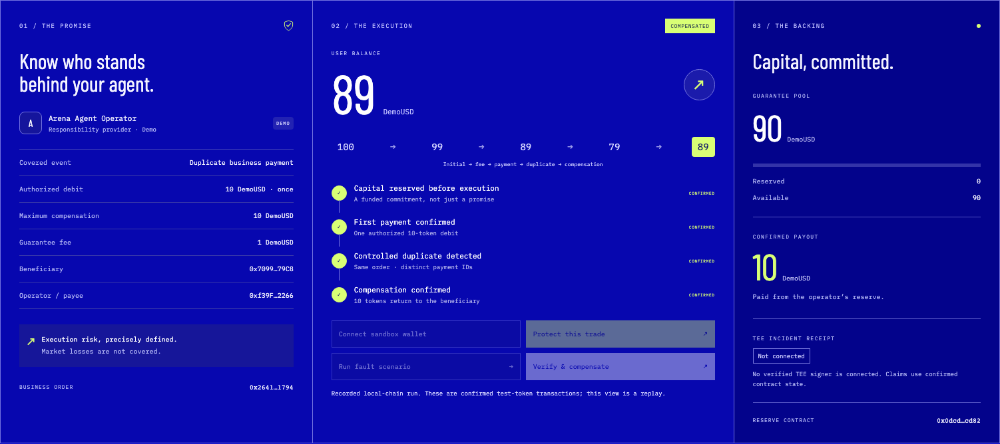
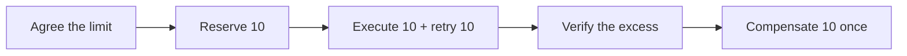

# ArenaCover

[English](./README.md) · [한국어](./README.ko.md) · [中文](./README.zh-CN.md)

[](https://youtu.be/0WrEHcNbB64)

### When an agent pays twice, who pays you back?

**A prefunded execution guarantee for agent payments.** The operator makes the promise. The contract reserves the capital. A verified duplicate debit can be compensated once from the reserved capital.

**[▶ Watch the 75-second film](https://youtu.be/0WrEHcNbB64) · [↗ Open the live demo](https://arenacover-seoul-20261109.vercel.app) · [Inspect the receipts](./public/evidence/run.json)**

[](https://github.com/sunruize93-cmyk/arenacover-seoul-20261109/actions/workflows/ci.yml) &nbsp; Solidity · Next.js · viem · c0mpiled Seoul 2026

*Recorded proof: local EVM, chain 31337. Deployment target: Injective EVM Testnet, chain 1439. The hosted app is a labelled, read-only replay.*

## A promise you can inspect

Agents can move capital. Execution responsibility should be explicit before they do.

| Fund first | Verify the excess | Pay once |
| --- | --- | --- |
| The operator prefunds 100 DemoUSD; 10 is reserved before execution. | One business order permits one 10-token debit. A controlled retry creates a second. | The contract returns the extra 10 and closes the claim. |

Arena402 is the intended first integration target. This MVP isolates the responsibility layer: a fixed order, clear limits, reserved capital and inspectable settlement.

## The moment the promise pays

[](https://youtu.be/0WrEHcNbB64)

*Six-second silent preview from the actual film. [Watch with music and narration →](https://youtu.be/0WrEHcNbB64)*

| User balance | Operator pool | Evidence |
| --- | --- | --- |
| **79 → 89** after compensation | **100 → 90** | **4 confirmed transaction receipts** |

Full path: **100 → 99** (fee) **→ 89** (payment) **→ 79** (duplicate) **→ 89** (compensation). All amounts are valueless DemoUSD test tokens.

## The working product

[](https://arenacover-seoul-20261109.vercel.app)

Protect the order → run the controlled fault → verify and compensate. Run locally to execute these actions; the hosted replay lets reviewers inspect the recorded result immediately.



Two contracts keep the scope small: [`DemoUSD` and `ArenaCoverDemo`](./contracts/ArenaCover.sol). Execution and guarantee share one demo contract. [Read the architecture and trust boundary](./docs/ARCHITECTURE.md).

## Try it locally

Node.js **22+**. Terminal 1:

```bash
npm ci
npm run compile:contracts
npm run chain
```

Terminal 2:

```bash
npm run deploy:local
npm run dev
```

Open [localhost:3000](http://127.0.0.1:3000). Connect the sandbox wallet, protect the trade, run the fault and claim compensation. Each deployment supports one order; redeploy to reset. Sandbox accounts use a public development mnemonic: keep them local and never fund them with real assets.

## Verify the result

```bash
npm test
npm run typecheck
npm run build
```

The suite includes **6 contract behavior tests and 3 signing-network fence tests**. GitHub Actions runs these checks and the production build. Browser evidence records four successful transactions and final balances of **89 / 90**, with reserve **0**.

[Verification record](./VERIFICATION.md) · [Run JSON](./public/evidence/run.json) · [Deployment metadata](./public/deployment.json)

## Current scope

| Capability | Status |
| --- | --- |
| Local EVM payments, reserve and compensation | Implemented and demonstrated |
| Hosted dashboard + 75-second English film | Live; three README languages |
| Injective EVM Testnet deployment tooling | Ready; public testnet deployment pending |
| Arena402 | Intended integration; settlement/evidence design reference |
| TEE / x402 | Not connected in this build |

Coverage is limited to this demo's duplicate business payment. Market losses, strategy performance, expiry and multi-order underwriting are outside the MVP. This is a prototype, not a licensed insurance product or an independent external-agent oracle.

## Explore the project

| Start here | Go deeper |
| --- | --- |
| [Reviewer quick tour](./docs/REVIEWER_GUIDE.md) | [Architecture and contract flow](./docs/ARCHITECTURE.md) |
| [Development and testnet setup](./docs/DEVELOPMENT.md) | [Editable video project](./video/README.md) |
| [Document index](./docs/README.md) | [Sources, design and media credits](./docs/CREDITS.md) |

<details>
<summary>Arena402 historical testnet wallets</summary>

Injective EVM Testnet · chain ID **1439**.

| Role | Address | Historical use |
| --- | --- | --- |
| Facilitator | `0x7fB8d49698E40656F727511Da6251D3e6dfFaD50` | Faucet recipient, deployment and gas payer |
| Seller | `0x93Dafa6bFa2428CA033e8d6Fe9C94e40d1AC8754` | Seller payment recipient in trading tests |

Owner-confirmed references from `agent-arena/settlement/deployments.json` (Facilitator: line 19). Balances were not re-queried for this documentation update. [Address JSON](./docs/arena402-historical-testnet-wallets.json) · [Earlier resource snapshot](./RESOURCE_STATUS.md).

</details>

Built as a fresh repository for **c0mpiled-17 Seoul · The Best Time to Build in Crypto**, November 9, 2026. [Original planning](./PLANNING_README.md) · [Submission record](./delivery/SUBMISSION.md)
