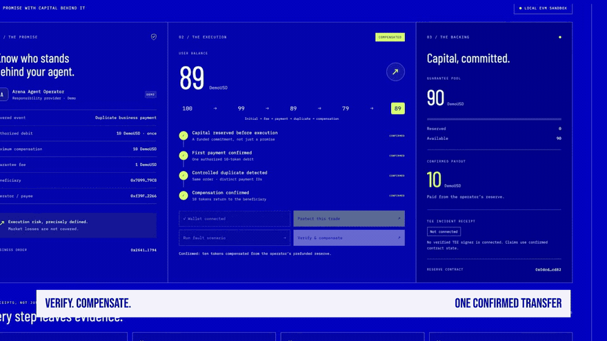
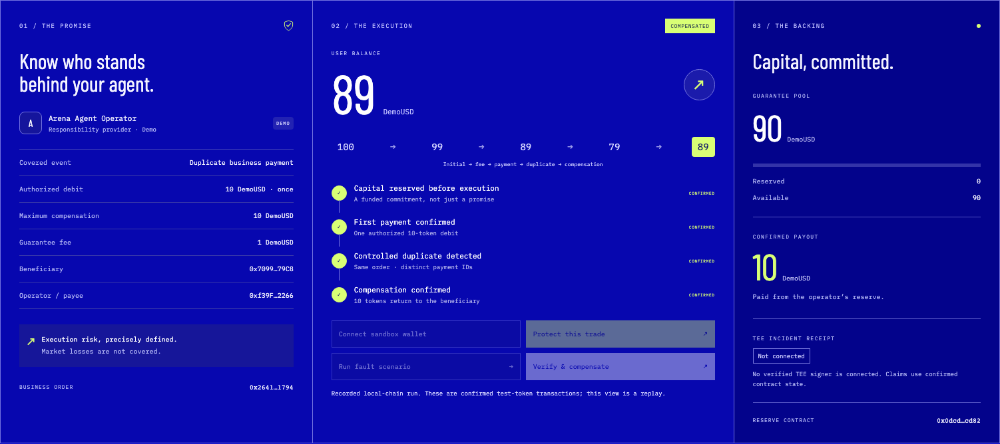
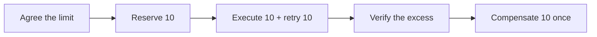

# ArenaCover

[English](./README.md) · [한국어](./README.ko.md) · [中文](./README.zh-CN.md)

[](https://youtu.be/0WrEHcNbB64)

### Agent 多扣了一笔，谁来赔？

**为 Agent 支付提供有预存资本支撑的执行保障。** 运营方明确承担责任，合约先锁定赔付资金，再验证重复扣款，并一次性补回超额部分。

**[▶ 观看 75 秒英文视频](https://youtu.be/0WrEHcNbB64) · [↗ 打开在线演示](https://arenacover-seoul-20261109.vercel.app) · [查看交易凭证](./public/evidence/run.json)**

[](https://github.com/sunruize93-cmyk/arenacover-seoul-20261109/actions/workflows/ci.yml) &nbsp; Solidity · Next.js · viem · c0mpiled Seoul 2026

*实际演示：本地 EVM，chain 31337。部署目标：Injective EVM Testnet，chain 1439。托管页面为明确标注的只读回放。*

## 有资金支撑的责任承诺

Agent 可以自主执行支付。执行之前，谁承担出错的责任，也应该同样明确。

| 先锁资 | 再验证 | 赔一次 |
| --- | --- | --- |
| 运营方预存 100 DemoUSD，执行前锁定 10。 | 同一业务订单只允许支付一次 10，故障注入器触发第二次扣款。 | 合约将多扣的 10 返还给用户，关闭本次索赔。 |

Arena402 是首个计划接入对象。本次 MVP 聚焦固定订单的责任闭环：明确规则、预存资本、验证超额扣款与可核验的赔付。

## 承诺兑现的瞬间

[](https://youtu.be/0WrEHcNbB64)

*实际成片中的 6 秒无声预览。[观看带音乐和英文旁白的完整视频 →](https://youtu.be/0WrEHcNbB64)*

| 用户余额 | 运营方资金池 | 证据 |
| --- | --- | --- |
| 赔付后 **79 → 89** | **100 → 90** | **4 笔确认交易凭证** |

完整路径：**100 → 99**（费用）**→ 89**（支付）**→ 79**（重复扣款）**→ 89**（赔付）。所有金额都是无价值的 DemoUSD 测试代币。

## 可以运行的产品

[](https://arenacover-seoul-20261109.vercel.app)

购买保障 → 执行故障 → 验证并赔付。本地版本可以亲自操作完整流程；在线回放便于评委立即查看已确认的结果。



两个合约保持实现简洁：[`DemoUSD` 与 `ArenaCoverDemo`](./contracts/ArenaCover.sol)。执行与保障逻辑位于同一演示合约。[架构和信任边界](./docs/ARCHITECTURE.md)。

## 本地启动

需要 Node.js **22+**。终端 1：

```bash
npm ci
npm run compile:contracts
npm run chain
```

保持本地链运行，在终端 2 执行：

```bash
npm run deploy:local
npm run dev
```

打开 [localhost:3000](http://127.0.0.1:3000)，依次连接沙盒钱包、购买保障、执行故障、验证赔付。每次部署支持一个订单，重新部署可准备新订单。沙盒使用公开开发助记词，仅限本地，不能转入真实资产。

## 核验结果

```bash
npm test
npm run typecheck
npm run build
```

测试包含 **6 项合约行为检查、3 项网络签名防护检查**。GitHub Actions 自动执行测试与生产构建。浏览器证据记录 4 笔成功交易，最终用户 / 资金池余额 **89 / 90**，锁定额 **0**。

[验证记录](./VERIFICATION.md) · [运行 JSON](./public/evidence/run.json) · [部署信息](./public/deployment.json)

## 当前完成范围

| 能力 | 状态 |
| --- | --- |
| 本地 EVM 支付、锁资与赔付 | 已实现并完成演示 |
| 在线界面与 75 秒英文视频 | 已上线；README 支持中英韩 |
| Injective EVM 测试网部署工具 | 已准备，尚未完成公开测试网部署 |
| Arena402 | 计划接入；参考支付阶段与证据设计 |
| TEE / x402 | 本版本未接入 |

仅覆盖本演示的重复业务支付；市场损失、策略表现、期限和多订单承保不在 MVP 范围内。这是原型，不作为持牌保险产品或独立外部 Agent 预言机提供服务。

## 继续了解

| 快速了解 | 深入查看 |
| --- | --- |
| [评委快速浏览路线](./docs/REVIEWER_GUIDE.md) | [架构与合约流程](./docs/ARCHITECTURE.md) |
| [开发与测试网接入](./docs/DEVELOPMENT.md) | [可编辑视频工程](./video/README.md) |
| [文档索引](./docs/README.md) | [来源、设计与媒体署名](./docs/CREDITS.md) |

<details>
<summary>Arena402 历史测试网钱包</summary>

Injective EVM 测试网 · Chain ID **1439**。

| 角色 | 地址 | 历史用途 |
| --- | --- | --- |
| Facilitator | `0x7fB8d49698E40656F727511Da6251D3e6dfFaD50` | 接收 Faucet 测试币、部署合约、支付 Gas |
| Seller | `0x93Dafa6bFa2428CA033e8d6Fe9C94e40d1AC8754` | 交易测试中的卖方收款地址 |

所有者确认的旧项目资料：`agent-arena/settlement/deployments.json`，Facilitator 位于第 19 行。本次文档更新未重新查询余额。[地址 JSON](./docs/arena402-historical-testnet-wallets.json) · [较早的资源快照](./RESOURCE_STATUS.md)。

</details>

全新仓库，非 Arena402 fork。为 **c0mpiled-17 Seoul · Crypto 赛道**于 2026 年 11 月 9 日开发。[原始策划](./PLANNING_README.md) · [提交记录](./delivery/SUBMISSION.md)
