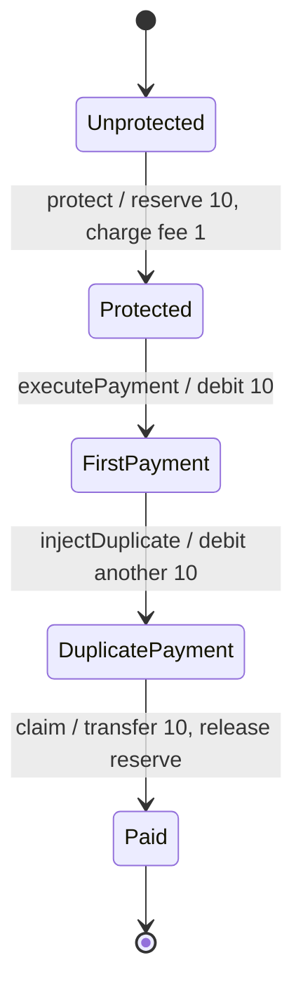
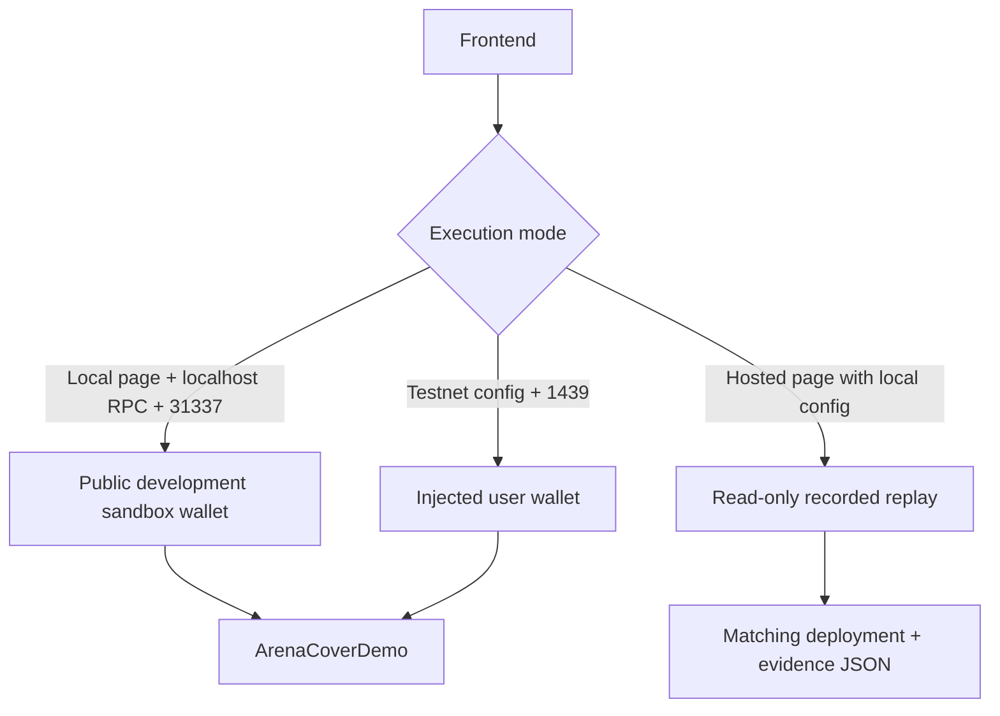

# Architecture

ArenaCover demonstrates one funded responsibility commitment for **one order, one beneficiary and one operator**.

## Components

| Component | Owns |
| --- | --- |
| `DemoUSD` | Fixed demonstration ERC20 supply; 6 decimals; initial user/operator balances of 100 each |
| `ArenaCoverDemo` | Fixed identities and order, terms hash, reserve, controlled payments and one-time compensation |
| Next.js / viem frontend | Wallet connection, actions, pending recovery, receipt persistence and replay presentation |
| Deployment/scenario scripts | Local EVM setup; separate Injective testnet wallet/deployment path; reproducible execution |
| Evidence JSON | Published snapshot tying four confirmed business-step transactions to one deployment |

Source: [contracts](../contracts/ArenaCover.sol) · [frontend](../src/app/page.tsx) · [scripts](./DEVELOPMENT.md).

## Contract state machine

`fund()` moves operator capital into the contract before protection. The premium and both business payments go to the operator/payee, while the guarantee pool remains separately held by the contract.

| Step | User | Guarantee pool | Reserved | Business amount paid |
| --- | ---: | ---: | ---: | ---: |
| Funded, before protection | 100 | 100 | 0 | 0 |
| Protect | 99 | 100 | 10 | 0 |
| First payment | 89 | 100 | 10 | 10 |
| Controlled duplicate | 79 | 100 | 10 | 20 |
| Compensation | 89 | 90 | 0 | 20 |

Units: DemoUSD. Token approvals and deployment/funding transactions are separate from the four recorded business steps.

## Verification and payout

- `termsHash` binds the version, chain, contract, order, user, operator, token, authorized debit, fee and cover.
- Only the fixed user can protect, execute the demo scenario and claim; only the operator can fund the pool.
- `protect()` requires sufficient available capital and reserves the full cover before the first debit.
- `claim()` requires the duplicate stage and exactly two authorized-size payments in recorded contract state.
- Payout updates the state to `Paid` and releases the reservation before the token transfer. A second claim cannot pass the stage check.
- OpenZeppelin `SafeERC20` and `ReentrancyGuard` are used. Failed transfers revert their associated state changes.

## Browser and network boundary

Live writes verify the expected network and fixed user. Receipt persistence precedes pending-state cleanup, allowing recovery after a reload. The hosted local-config branch loads matching recorded evidence rather than connecting to a visitor's localhost chain.

## Trust boundary

Execution and verification are combined in the **same demo contract**. The duplicate is an explicit fault injection with two distinct payment IDs, not a signature replay exploit. The contract checks its own recorded payments; it does not independently attest to arbitrary external agent activity.

Arena402 is the first intended integration. Separating the real executor, verified incident evidence and guarantee contract is future integration work. The current build does not contain a connected TEE verifier, x402 settlement, an autonomous trading runtime or a production underwriting system.

The public proof is local EVM chain **31337**. Injective EVM Testnet **1439** is the deployment target; its tooling is not evidence of a completed public deployment.
